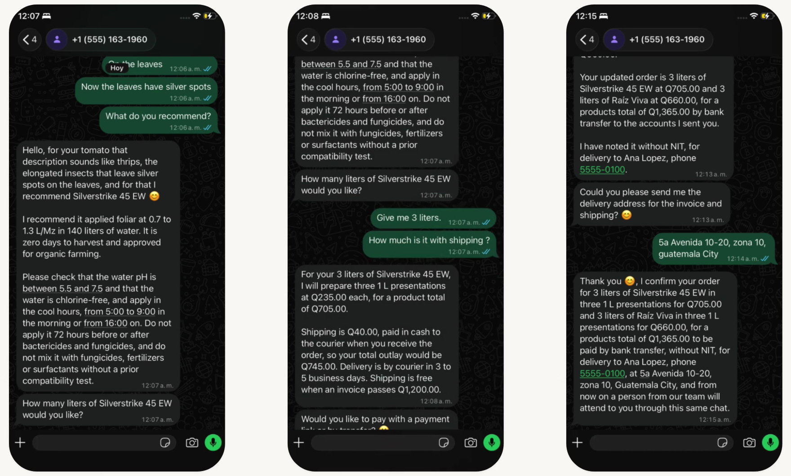

# Open Market

### AI-powered sales advisor for agricultural businesses

**Making frontier AI accessible to small businesses, one agent at a time.**

Open Market is a multimodal AI sales advisor built for agricultural input distributors. It helps farmers identify crop problems, find the right products, understand application instructions, and complete purchases through a conversation, on WhatsApp or on a public chat page.

A farmer can describe a problem using text, voice, or a photograph. The advisor searches the distributor's catalog, retrieves relevant technical datasheets, provides evidence-backed recommendations, calculates the order, and guides the customer through the purchasing process.

When the available documentation does not support a recommendation, the advisor does not guess. It asks for clarification or escalates the case to a human agronomist.

Built with Meta's Model API and Muse Wonder, Open Market demonstrates how frontier AI models can power practical business operations, even without a dedicated AI engineering team.

**Video demonstration (on WhatsApp):** [Watch on YouTube](https://youtu.be/xiqOojwoQAs)

**Live demo:** [Try Open Market](https://open-market-28985494187.europe-west1.run.app/)

**GitHub:** [gtavo95/open-market](https://github.com/gtavo95/open-market)



*A sale on WhatsApp, from the demo video: the diagnosis, the quote with shipping, and the confirmed order. Fictional distributor, customer, and data.*

---

## What is new and what already existed

Open Market is a startup entry: it builds on an existing product. **The agent in this repository is the hackathon work.** The messaging platform it runs on was not built for the hackathon, and we do not present it as a contribution.

| In the video | Status |
|---|---|
| The advisor's answers, the catalog search, the dose, and the priced order ("The sale, on WhatsApp") | **Hackathon work:** the agent, moved to English and to Muse Wonder on the Meta Model API, based on an earlier agent by the same developer |
| The connection between the agent and the platform (`/consultas`, `src/wire`) | **Built during the hackathon** |
| The test user and the test integration with Meta | **Created during the hackathon** for this demo |
| The model comparison ("Why Muse Wonder") | **Built during the hackathon** |
| The WhatsApp channel itself | **Already existed**, shown only as the place where the agent runs |
| The chatroom, the handoff, and a person stepping in ("Human in the loop", and the closing line "A person can step in at any moment") | **Already existed**, not a hackathon contribution; shown only to explain where the agent hands off |

Photo and voice input with Muse Wonder and the public chat page were also built during the hackathon. They can be tried on the live demo.

The full list is under [What was built during the hackathon](#what-was-built-during-the-hackathon).

---

## The vision: Democratizing access to AI

Open Market is part of a broader vision: making advanced artificial intelligence accessible to small and medium-sized businesses that cannot afford to build and maintain specialized AI teams.

Many businesses have valuable products, established customer relationships, and existing sales channels, but lack the resources to automate their operations or take full advantage of modern AI capabilities.

We believe these businesses should not be left behind.

By connecting frontier AI models to their existing business processes, knowledge, and communication channels, companies can deploy specialized AI agents that help them:

- Serve more customers without proportionally increasing operational costs.
- Expand their sales capacity and improve customer response times.
- Make better use of their existing tools, knowledge, and resources.
- Free customer service teams from repetitive inquiries so they can focus on higher-value activities.
- Compete more effectively in their local markets.

Our goal is not to replace the people who make these businesses work. It is to give them better tools to scale their impact.

### Real-world experience behind the project

This vision comes from practical experience building AI agents for businesses through Baalam, across industries that include biotechnology clinics, funeral services, restaurants, and independent entrepreneurs.

Open Market brings this vision into the agricultural sector.

---

## The problem

Agricultural distributors face a particular challenge: their customers often need technical guidance before making a purchase.

A farmer might describe a disease using local terminology, send a photograph of damaged leaves, or explain a problem through a voice message.

The sales representative must understand the problem, identify an appropriate product, consult technical documentation, explain the correct dosage, calculate quantities, and guide the customer through payment.

This process is time-consuming and difficult to scale.

It also requires specialized knowledge. Recommending a product without sufficient evidence or providing an incorrect dosage can have real consequences.

Small distributors often cannot afford to have specialized personnel available around the clock.

## The solution

Open Market turns the distributor's product catalog and technical documentation into an interactive sales advisor.

The experience follows a conversational workflow:

1. **Understand the problem:** The farmer describes a crop issue through text, voice, or an image.
2. **Identify the relevant information:** The agent interprets the request and searches the distributor's catalog.
3. **Retrieve technical evidence:** It reads the relevant datasheets and verifies product applicability, crops, pests, and dosage.
4. **Recommend a solution:** The advisor explains its recommendation and references the source documentation.
5. **Build the order:** It gathers the required information, calculates quantities, and maintains the sales plan throughout the conversation.
6. **Guide the purchase:** It can propose sending datasheets or payment information through the connected communication channel.
7. **Escalate when necessary:** If the documentation is insufficient or the request requires human intervention, it proposes a handoff to an agronomist.

The distributor remains in control of its catalog, commercial policies, and customer relationships.

---

## Built for the Meta AI Developer Hackathon

**Theme: Build for Your World**

Open Market uses Meta's Model API with Muse Wonder to power its conversational and multimodal capabilities.

The model is integrated into an existing agent architecture through a dedicated provider adapter.

### What was built during the hackathon

This project builds on earlier work by the same developer. The underlying agricultural sales advisor originated from an agent developed for real-world business applications, and `catalejo`, the agent library in `vendor/`, predates the hackathon.

The agent is what was worked on for this event. It was integrated into an existing messaging platform, and that platform was not built for the hackathon: its WhatsApp integration, its chatroom for human agents, and its human handoff all existed before. The platform also supports Instagram and Facebook. For this demo, a test user and a test integration with Meta were created.

The hackathon work focused on adapting and extending that foundation:

- Migrated the advisor, prompts, catalog, evaluation cases, and documentation to English.
- Implemented the Muse adapter and integrated Meta's Model API.
- Evaluated four Muse model configurations and selected the default based on measured results.
- Added image and voice input using Muse Wonder.
- Implemented a public conversational interface.
- Added streaming responses and real-time execution traces.
- Integrated the agent into the existing platform through the `/consultas` route and the `src/wire` translation layer.
- Created a test user and a test Meta integration on the platform for the demo.
- Deployed the application to Google Cloud Run.

### Why Muse Wonder?

Muse Wonder enables the advisor to work with different forms of customer input without requiring separate perception services for images and audio.

Both modalities are processed through the Meta Model API, and their resulting text is integrated into the existing agent workflow.

This allows the same catalog search, evidence retrieval, recommendation validation, and sales orchestration mechanisms to operate across text, images, and voice.

---

## WhatsApp and the platform

The advisor runs on WhatsApp, and the video above shows a full sale conversation there, followed by a person taking over in the chatroom.

The WhatsApp channel and the chatroom come from an existing platform, outside this repository, which also supports Instagram and Facebook. The demo uses a test user and a test integration with Meta.

The platform receives the customer's messages and calls `POST /consultas` once per customer message. `src/wire` translates between the platform's contract and the advisor's own types. The platform delivers the replies and executes the effects the advisor proposes.

Photo and voice input run through `/chat`, on the public page. `/consultas` handles the text of the turn.

---

## Multimodal capabilities

### Image understanding

Farmers can upload photographs of affected crops or plants.

Muse Wonder interprets the image and produces a description of the observed symptoms, including an indication of uncertainty.

The resulting description becomes part of the customer's conversation.

An important design decision: **the image model is not allowed to recommend products.** Product recommendations must come from the distributor's technical documentation.

### Voice understanding

Farmers can submit voice messages instead of typing.

Muse Wonder transcribes the recording, and the resulting text follows the same processing pipeline as a regular text message.

This makes the interface more accessible to customers who prefer speaking or have limited time to write detailed descriptions.

### Evaluation results

The following tests were performed through `/chat` on November 3, 2026, with three runs per case unless otherwise specified. Photos are Wikimedia Commons images. Voice notes are macOS text-to-speech, and the noisy one has noise added by software. Results were read by hand.

| Case | Result |
|---|---|
| Powdery mildew on squash (photo) | 2/3 recommended Escudo with the datasheet dosage; 1 requested crop clarification |
| Coffee leaf rust (photo, absent from catalog) | No product recommendation in 3/3 runs |
| Thrips damage on hydrangea (photo) | No product recommendation in 3/3 runs; uncertain identification led to clarification or escalation |
| Tractor (photo) | No product recommendation in 2/2 runs |
| Clean English voice | Exact transcript and correct product in 3/3 runs |
| Noisy English voice | Correct understanding in 1/3 runs; misheard messages were escalated |
| Spanish voice | Exact transcript and Spanish response in 2/2 successful runs |

No tested run recommended an incorrect product.

These are preliminary results from a small evaluation sample, not a statistically representative benchmark. Two perception requests failed during testing, and retries were subsequently added. Those retries have not been measured at this scale.

Observed response times:

- Image requests: 48 to 81 seconds.
- Voice requests: 36 to 63 seconds.

Real-world farmer recordings and browser-recorded audio remain areas for further evaluation.

---

## Model evaluation

We evaluated four configurations using the project's evaluation suite.

The benchmark included six conversational scenarios, with three runs per configuration, for 18 turns per configuration.

Measurements were collected on November 3, 2026.

| Configuration | Correct | Criterion | Order right | Seconds/turn |
|---|---:|---:|---:|---:|
| Muse Wonder 1.0, medium | 16/18 | 18/18 | 6/9 | 45 |
| Muse Wonder 1.0, low | 16/18 | 17/18 | 6/9 | 39 |
| Muse Spark 1.3 Contributor, low | 9/18 | 17/18 | 3/9 | 44 |
| Muse Spark 1.3 Contributor, medium | 8/18 | 18/18 | 3/9 | 112 |

**Default configuration: `muse-wonder-1.0`, medium effort.**

Correctness measures whether the answer cites the expected source. Criterion is a TypeSafe judge evaluating the answer against the scenario. Order right measures whether the resulting order is correct.

The sample is small, and the results should be interpreted accordingly: three runs do not separate low from medium on Wonder. The default also moves between runs. After the last prompt changes it read 15/18, 17/18, and 16/18, with the criterion at 18/18 and orders at 6/9 all three times. The benchmark helped us select a practical configuration, rather than claiming a definitive model ranking.

One known limitation remains: on the turn that adds a second product, the internal cart reads 6 L of the first product for one turn, and it is right again on the next turn.

---

## Technical architecture

Open Market is built around a role-based agent architecture.

The model does not receive the entire product catalog as context. Instead, it interacts with a controlled REPL workspace and retrieves information through code.

### Catalog retrieval and grounding

The catalog is stored in `okf/` and contains the fictional distributor Agroinsumos Ceiba's product documentation.

The agent has access to:

- `grep`: identifies which datasheets contain a search term.
- `read`: retrieves the full contents of a datasheet.
- `products`: a parsed index containing product information, certified crops, pests, dosages, and safety information.

Each recommendation is associated with its source documentation.

This approach keeps the model from relying solely on its pretrained knowledge when making technical recommendations.

### Agent roles

The advisor separates responsibilities:

- **Searcher:** queries the catalog and produces a report with the datasheets used.
- **Writer:** communicates with the customer using the distributor's defined sales persona.
- **Sale:** maintains the purchasing plan and validates the required information.
- **Effects:** proposes actions such as sending a datasheet, sharing payment information, or escalating a case.
- **Escalation:** identifies situations that require human intervention.

The sales plan and proposed effects travel with the customer between requests. The service itself does not maintain conversation state.

### Controlled sales orchestration

The sales process is represented as a structured plan with stages such as diagnosis, payment, and billing.

TypeSafe evaluates whether the customer has provided the information required to advance through the process.

This avoids relying exclusively on keyword matching or asking customers for information they have already provided.

The agent can track:

- Crop and pest information.
- Affected area.
- Purchase intent.
- Payment method.
- Billing information.
- Pending actions and completed steps.

### Human-in-the-loop

Human-in-the-loop is part of the existing platform. When a case needs a person, the advisor proposes a handoff and the bot pauses. A person takes the conversation in the chatroom, with the form and the cart already filled in, and can hand it back to the agent.

The advisor does not execute external actions directly.

Instead, it proposes effects that the connected application can execute. For example:

- Sending a product datasheet.
- Sharing payment account information.
- Creating a human handoff.

This separation helps prevent duplicate actions when requests are retried and allows the communication channel to retain control over external operations.

---

## Technology stack

- **AI:** Meta Model API, Muse Wonder.
- **Agent framework:** catalejo.
- **Evaluation:** TypeSafe.
- **Backend:** Python, FastAPI.
- **Execution:** Isolated REPL workspaces.
- **Channels:** WhatsApp through an existing platform, public web page.
- **Deployment:** Docker, Google Cloud Run.
- **Testing:** pytest, mypy.
- **Interface:** HTML, JavaScript, HTTP streaming.
- **Catalog:** Markdown datasheets and a parsed product index.

---

## Quickstart

### Requirements

You need:

- Python and `uv`.
- A Meta Model API key.
- A TypeSafe API key.

### Installation

```bash
uv sync

cp .env.example .env
```

Configure the following variables in `.env`:

```env
MUSE_API_KEY=your_meta_model_api_key
TYPESAFE_API_KEY=your_typesafe_api_key
```

Run the conversational interface:

```bash
uv run --env-file .env cli.py
```

Try asking:

```text
I have 2 manzanas of tomato with silver spots
on the leaves and little elongated bugs.
```

### Run the HTTP application

```bash
uv run uvicorn main:app --app-dir src --reload
```

### Tests and evaluation

```bash
just ci

uv run pytest

uv run mypy

uv run python -m evals
```

---

## Project structure

```text
open-market/
├── src/
│   ├── core_agent/
│   │   ├── roles/
│   │   └── world/
│   ├── host/
│   ├── routes/
│   ├── web/
│   ├── wire/
│   ├── config.py
│   └── main.py
├── evals/
├── tests/
├── okf/
│   ├── products/
│   ├── voice.md
│   └── verify.sh
├── vendor/
├── scripts/
├── cli.py
├── Dockerfile
└── pyproject.toml
```

- `core_agent/` contains the agent implementation and its roles.
- `host/` connects the agent to the application and manages execution.
- `routes/` exposes the REST and A2A endpoints.
- `wire/` translates between the platform's contract and the advisor's types.
- `okf/` contains the distributor's catalog and sales persona.
- `evals/` contains the evaluation scenarios and quality suite.
- `tests/` contains the automated test suite.
- `vendor/` contains the vendored catalejo library.

## API endpoints

| Method | Endpoint | Description |
|---|---|---|
| GET | `/` | Public conversational interface |
| POST | `/chat` | Conversational endpoint supporting text, images, and audio |
| POST | `/chat/stream` | Streaming conversation with execution traces |
| POST | `/consultas` | The platform's turn, authenticated, with an optional NDJSON stream |
| POST | `/queries` | Agent REST interface |
| GET | `/queries/catalog` | Catalog and execution statistics |
| GET | `/health` | Application health |

### Agent-to-Agent (A2A)

The advisor also exposes an A2A interface for other agents to consume.

- `GET /.well-known/agent-card.json`: Agent Card.
- `POST /a2a`: JSON-RPC 2.0 `message/send`.

The response includes structured evidence, grounding information, and the sales and effects state.

---

## Limitations and future work

Open Market is a working prototype, not a complete commercial deployment.

Current limitations and opportunities include:

- Improving image and voice perception reliability.
- Bringing photo and voice input to the WhatsApp channel.
- Testing with real farmers and real-world agricultural photographs.
- Reducing multimodal response latency.
- Improving multi-product cart consistency.
- Finishing the close of a WhatsApp sale: registering the order and telling the customer what the platform closed.
- Connecting the advisor to real distributor catalogs and inventory systems.
- Connecting proposed effects to payment systems and CRM platforms.
- Expanding evaluation coverage across more agricultural scenarios.

The current catalog belongs to Agroinsumos Ceiba, a fictional Guatemalan distributor created for this demonstration.

---

## About the developer

Built by **[Gustavo Gordillo](https://github.com/gtavo95)**, a software and mechatronics engineer working on AI agents, distributed systems, and business automation.

Open Market is a solo-developer submission to the **Meta AI Developer Hackathon: Build for Your World**.

It is also part of a larger effort to make frontier AI accessible to businesses that have traditionally lacked the resources to adopt it.

**Our belief is simple: access to advanced AI should not depend on the size of your engineering team.**

---

## Acknowledgments

- Meta for the Model API and Muse models.
- The catalejo project, which provides the agent primitives used by this application.
